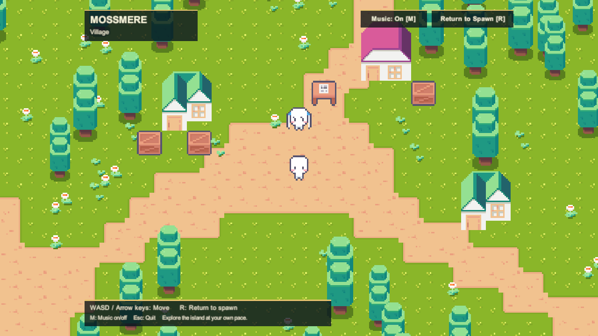

# Mossmere — Unity sandbox activity

A small top-down exploration game by Tinenen-cs, built with Goldmetal's **Top-Down 2D RPG Assets Pack** (Asset Store product 188718).

The supplied demo's house and tree assemblies become an island village with branching woodland trails, a flower meadow, a northern lookout, a lakeside pier, and a southern walking loop. Paths bend between asymmetrical clearings. Trees and flowers form uneven clusters. A compact English HUD shows the area, controls, music toggle and return button.

## Play

- **WASD / arrow keys:** walk.
- **R:** return to the village spawn.
- **M:** turn the original background music on or off.
- **Escape:** quit the Windows game.
- Walk into a glowing cyan ring labeled **RETURN TO SPAWN** at a trail endpoint to return home. The ring pulses and projects a light beam. Nearby guidance explains what it does.

Return zones clear movement and angular velocity, restore the player collision and renderer layers, and recenter the camera. Controls remain briefly locked after returning to prevent a held key from carrying the player away immediately.

## Open the project

1. Install Unity **6000.3.27f1**, with Windows build support.
2. Open the `FINALS_SANDBOX` project folder in Unity Hub.
3. Import [Goldmetal's exact asset pack](https://assetstore.unity.com/packages/2d/characters/top-down-2d-rpg-assets-pack-188718) into this project. Keep its original `Assets/TopDown 2D RPG BE3` path and metadata. The publisher's source artwork is obtained separately from the Asset Store and is excluded from this public repository.
4. Open `Assets/Scenes/Mossmere.unity` and enter Play mode.

The original pack demo stays unchanged at `Assets/TopDown 2D RPG BE3/Demo/Demo.unity`. The expanded scene retains its original assemblies in a disabled reference object.

## Reproduce and validate

- `Mossmere > Generate expanded demo` regenerates the scene using the original imported demo.
- With Unity open, write `test` into `FINALS_SANDBOX/workshop.command` to run the automated Play mode traversal checks.
- Write `build` into the same file, or use `Mossmere > Build Windows x64`, to build the Windows player.
- Results and captured Play mode views are in `FINALS_SANDBOX/QA`.

The checks move the real Rigidbody2D player through the generated world, enter all four return zones, deliberately alter collision/rendering state, verify the reset, and traverse the southern loop. Test-only behaviour is compiled out of the Windows player.

The revised game passed **53 Play mode checks**. See [the recorded results](FINALS_SANDBOX/QA/playcheck-result.txt) and the screenshots in the same folder. Checks include the English HUD buttons, audible music samples, glowing beacon visuals, actual traversal, and all return-state resets. A separate opt-in `-sandboxSmoke` check validates the built Windows player; it is inactive during normal play.

Windows deliverables are packaged locally in `Deliverables`; the ZIP includes the executable, data directory, Unity player DLL, Mono runtime, and other emitted runtime files. Build binaries are not uploaded to GitHub.

The revised local backup is `Deliverables/Mossmere-Windows-x64-v2.zip`. Extract the entire folder, then run `Mossmere.exe`. The original v1 ZIP remains available separately.

For the Canvas instruction to use WinRAR to make an executable, submit **`Deliverables/Mossmere-Canvas-Submission.exe`**. This is a real WinRAR self-extracting archive containing the complete Windows game and its runtime folders. Open it, choose an extraction destination, and run `Mossmere-Windows-x64-v2/Mossmere.exe` from the extracted folder. The executable alone from Unity's build directory is not a complete portable submission. The packager tests archive integrity, compares every extracted file hash, and launches the extracted game for a standalone smoke check. Results are in `canvas-submission-result.json`.

The submission executable is approximately **32.9 MB**; the ZIP backup is approximately **40.4 MB**. Both contain the complete 185-file game folder.

## Credits

Art: **Goldmetal**, Top-Down 2D RPG Assets Pack v1.0, © 2021 Goldmetal. [Publisher](https://www.goldmetal.co.kr). Source sprites and demo are used at their original pixel-art scale with point filtering. Unity and its runtime remain subject to their respective licenses.

Music: **Mossmere Meadow**, an original 40-second synthesized chiptune composition created for this activity. Source composition is in `tools/create_music.py`; the rendered stereo WAV is included in the Unity project.
